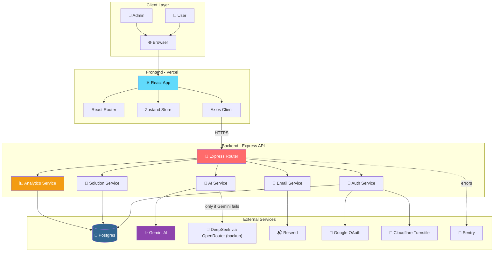
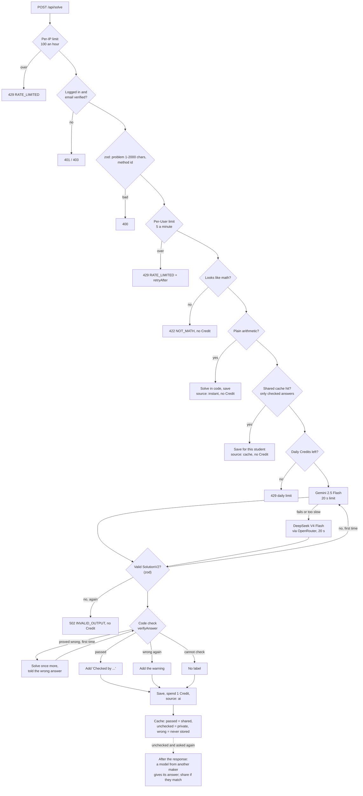
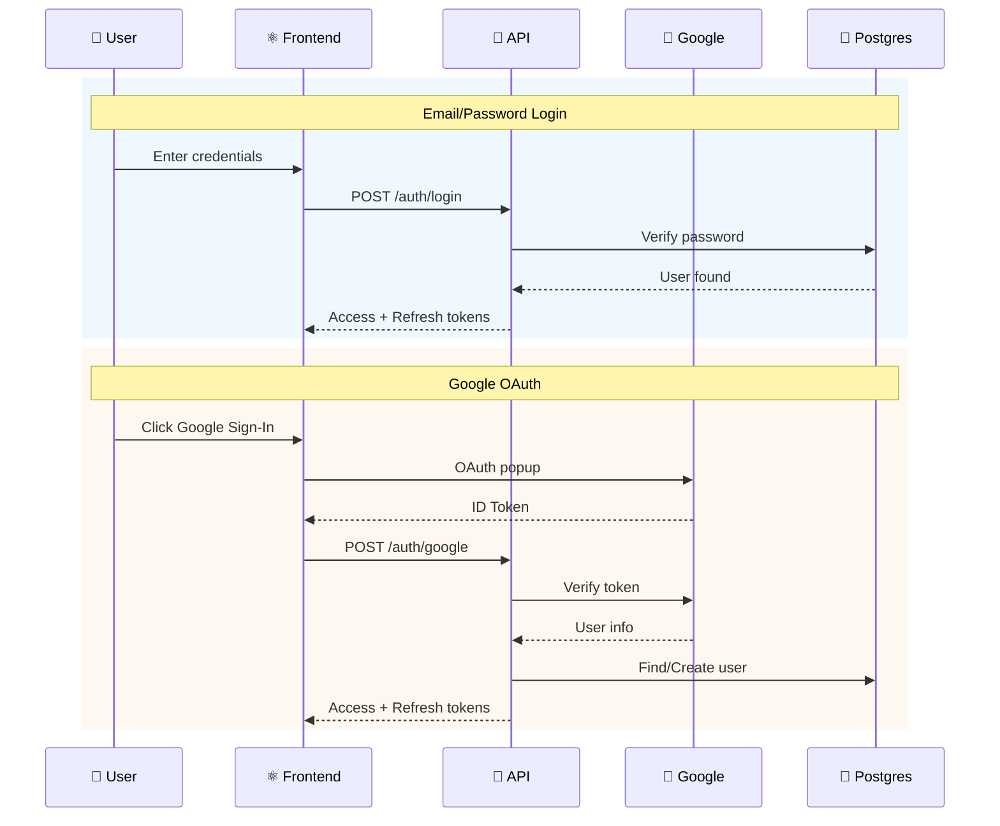
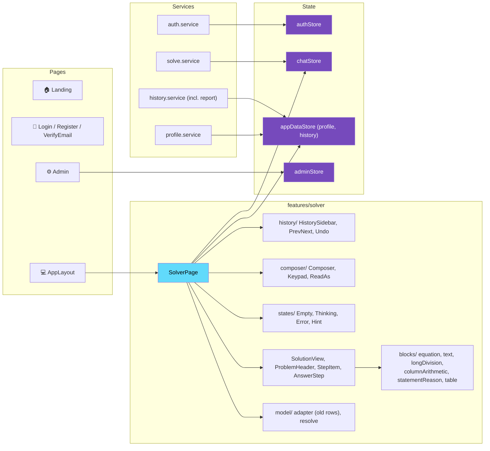
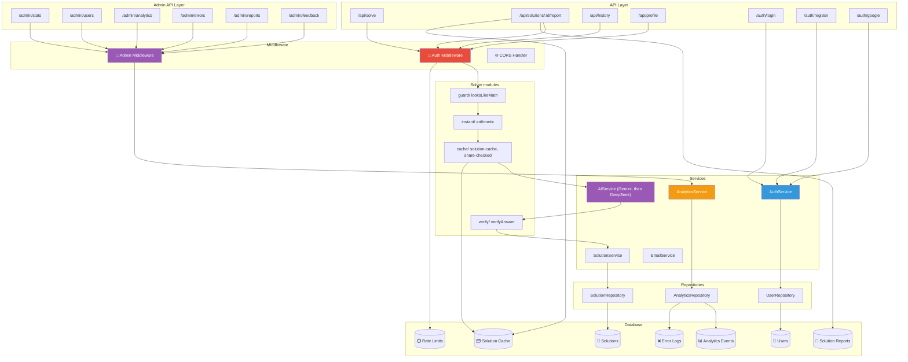
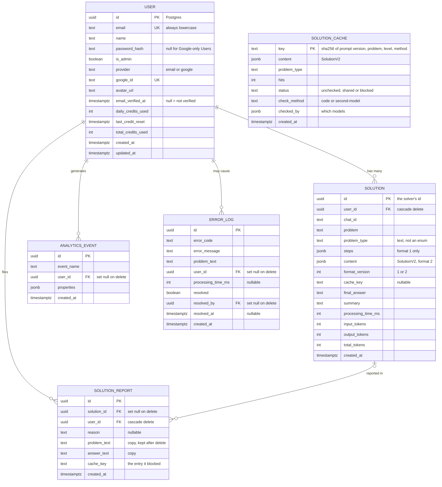
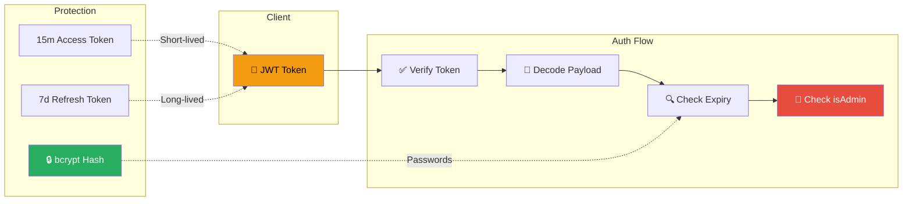
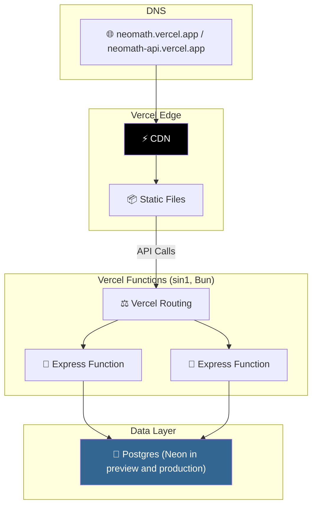

# NeoMath Architecture

> A comprehensive overview of the NeoMath system architecture

---

## System Overview

---

## Solve Flow

What `POST /api/solve` does, in order. Each early exit costs no AI call; only
an AI solve spends one of the 5 daily Credits.

- **Failover is sequential**, not a race (`services/ai/failover.ts`): the
  backup only starts once Gemini has failed or timed out, so we never pay
  for two answers and a failing backup can never cancel a working primary.
  It is on only when `USE_MULTI_MODEL=true`.
- **The format check** (`services/ai/generate-solution.ts`) parses the
  model's JSON with the `SolutionV2` zod schema, repairs LaTeX written with
  single backslashes, and asks once more if it is still invalid.
- **The code check** (`modules/solver/verify/verify-answer.ts`) substitutes
  roots back, recomputes arithmetic, and compares derivatives and integrals
  at random points. It parses with mathjs and runs only an allowlisted tree,
  never `eval`. Only this code may write `answer.check` or `answer.warning`.
- **The shared cache** (`modules/solver/cache/`) is keyed on the prompt
  version, the tidied problem and the method. A report blocks an entry for
  good (`POST /api/solutions/:id/report`, 10 an hour per account).

---

## Authentication Flow

---

## Frontend Architecture

The app is one page (`/app`), `features/solver/`. A solution is a list of
steps, and each step draws one typed block (see
[solution-format.md](solution-format.md)).

- The profile is fetched once per load and shared (`appDataStore`), and
  refreshed after each solve for the "N of 5 free problems left" line.
- Old solutions (format 1) are drawn through `model/adapter.ts`, which turns
  each old step into an `equation` block. Nothing in the database is
  rewritten.
- AI text is never rendered as raw HTML: math goes through KaTeX with
  `trust` off, everything else is plain React text.

---

## Backend Architecture

---

## Tech Stack

### Frontend

| Technology                                                                                        | Purpose          |
| ------------------------------------------------------------------------------------------------- | ---------------- |
|                  | UI Framework     |
|  | Type Safety      |
|                      | Build Tool       |
|       | Styling          |
|                                           | State Management |

### Backend

| Technology                                                                              | Purpose        |
| --------------------------------------------------------------------------------------- | -------------- |
|   | HTTP API       |
|             | Runtime (dev)  |
|  | Database       |
|  | ORM            |
|  | Authentication |

### External

| Technology                                                                                  | Purpose             |
| ------------------------------------------------------------------------------------------- | ------------------- |
|                        | AI Processing       |
|  | Social Login        |
|                                  | Transactional Email |

---

## Data Models

All data lives in Postgres. The solution cache stores nothing about the
student; `solutions.cache_key` links a student's copy to its cache entry so a
report can block it. Rate limits live in a small `rate_limits` table (one row
per key and window).

---

## Security Architecture

---

## Deployment Architecture

---

_Last updated: October 14, 2026 (solver redesign: solve flow, cache, reports)_
